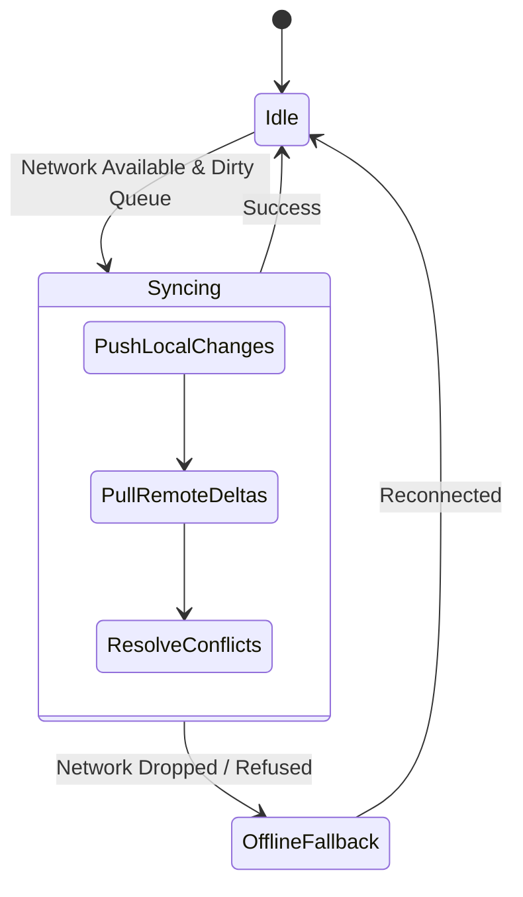
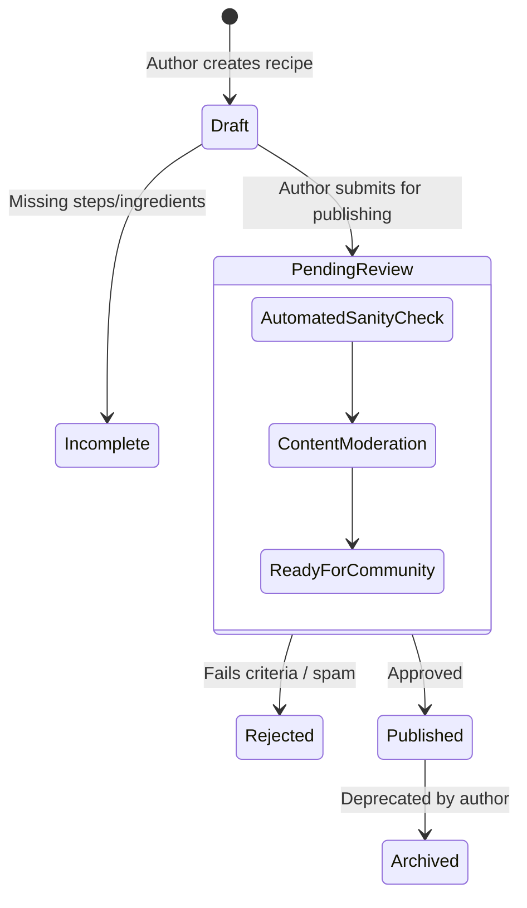

# Luto (Logo: Lu2) — Feature & Engine Specification
**Algorithmic Engines, Offline Sync Pipelines, and Kitchen Execution UX**
_Document Version: 1.0.0 · Status: Final Feature Specification · Date: October 2026_

---

## 1. "What's in My Fridge?" Pantry Matching Engine

### 1.1 Objective & Design Principles
The "What's in My Fridge?" engine transforms unstructured lists of available user ingredients into a ranked list of executable recipes. 

Unlike naive search engines that execute strict subset matching (which discards recipes if a single pinch of spice is absent), Luto implements **Culinary-Aware Weighted Matching**:
1. **Universal Staples Exemption**: Common seasonings and basic cooking mediums (water, salt, black pepper, neutral cooking oil) are considered implicitly available or penalty-free.
2. **Tiered Ingredient Importance**: Missing 200g of ribeye steak should drastically penalize a recipe score, whereas missing a sprig of parsley for garnish should only trigger a minor cosmetic penalty.
3. **Substitution Bridging**: If a user lacks an ingredient but possesses an approved culinary substitute in their pantry, the recipe is marked as "Substitutable" with a near-perfect score.

### 1.2 Mathematical Formulation

For a given recipe $R$ containing ingredients $\{i_1, i_2, \dots, i_n\}$ and a user pantry $P$:

$$\text{PantryMatchScore}(R, P) = \max\left(0, \frac{\sum_{i \in R} w(i) \cdot S(i, P) - \text{Penalty}_{\text{critical}}}{\sum_{i \in R} w(i)}\right) \times 100$$

#### Component Weights $w(i)$:
- **Tier 0 (Universal Staples)**: $w(i) = 0.0$ (Excluded from denominator and numerator penalty; assumed present).
- **Tier 1 (Core Base / Protein / Primary Starch)**: $w(i) = 3.5$ (e.g., chicken thigh, tofu, pasta, rice, salmon).
- **Tier 2 (Secondary Vegetables & Structural Flavor)**: $w(i) = 2.0$ (e.g., onions, garlic, carrots, coconut milk, crushed tomatoes).
- **Tier 3 (Finishing, Seasonings & Optional)**: $w(i) = 0.8$ (e.g., sesame seeds, garnishes, optional herbs).

#### Match State Function $S(i, P)$:
$$S(i, P) = \begin{cases} 
1.0 & \text{if } i \in P \text{ (Exact match with sufficient quantity)} \\
0.9 & \text{if } \exists s \in P \text{ where } s \text{ is an approved 1:1 substitute for } i \\
0.75 & \text{if } \exists s \in P \text{ where } s \text{ is an approved emergency substitute for } i \\
0.5 & \text{if } i \text{ is marked } \text{is\_optional} = \text{true} \\
0.0 & \text{if } i \notin P \text{ and no substitute exists}
\end{cases}$$

#### Critical Missing Penalty $\text{Penalty}_{\text{critical}}$:
$$\text{Penalty}_{\text{critical}} = 1.5 \times \text{Count}(\text{Missing Tier 1 Core Ingredients})$$

### 1.3 Match Tiers for Client Display
- **100% — Ready to Cook**: User has all required ingredients (or direct 1:1 substitutes).
- **80%–99% — Almost There (Missing 1–2 minor items)**: Cookable now by omitting non-critical garnishes or utilizing emergency pantry workarounds.
- **50%–79% — Quick Grocery Stop (Missing key component)**: Highlights exactly which single core item is required to unlock the meal.
- **< 50% — Low Match**: Filtered out by default from the primary pantry feed.

### 1.4 Algorithmic Pseudocode (TypeScript)

```typescript
export interface IngredientRequirement {
  id: string;
  name: string;
  isStaple: boolean;
  isOptional: boolean;
  tier: 0 | 1 | 2 | 3;
  amount: number;
  unit: string;
}

export interface PantryItem {
  ingredientId: string;
  quantity: number;
  unit: string;
}

export interface MatchResult {
  recipeId: string;
  matchScore: number;
  missingIngredients: IngredientRequirement[];
  substitutedIngredients: Array<{
    original: IngredientRequirement;
    substituteId: string;
    ratio: number;
  }>;
  canCookNow: boolean;
}

export function evaluatePantryMatch(
  recipeId: string,
  requirements: IngredientRequirement[],
  pantry: Map<string, PantryItem>,
  substitutionMatrix: Map<string, SubstitutionRule[]>
): MatchResult {
  let totalWeight = 0;
  let earnedScore = 0;
  let missingCriticalCount = 0;
  const missingIngredients: IngredientRequirement[] = [];
  const substitutedIngredients: MatchResult['substitutedIngredients'] = [];

  for (const req of requirements) {
    // Tier 0 staples are universally assumed present
    if (req.isStaple || req.tier === 0) {
      continue;
    }

    const weight = req.tier === 1 ? 3.5 : req.tier === 2 ? 2.0 : 0.8;
    totalWeight += weight;

    // 1. Direct pantry check
    if (pantry.has(req.id)) {
      earnedScore += 1.0 * weight;
      continue;
    }

    // 2. Substitution check
    const availableSubstitutes = substitutionMatrix.get(req.id) || [];
    let substituteFound = false;

    for (const sub of availableSubstitutes) {
      if (pantry.has(sub.substituteIngredientId)) {
        const subScore = sub.isEmergency ? 0.75 : 0.90;
        earnedScore += subScore * weight;
        substitutedIngredients.push({
          original: req,
          substituteId: sub.substituteIngredientId,
          ratio: sub.conversionRatio
        });
        substituteFound = true;
        break;
      }
    }

    if (substituteFound) continue;

    // 3. Optional ingredient check
    if (req.isOptional) {
      earnedScore += 0.5 * weight;
      continue;
    }

    // 4. Missing required ingredient
    missingIngredients.push(req);
    if (req.tier === 1) {
      missingCriticalCount++;
    }
  }

  if (totalWeight === 0) {
    return { recipeId, matchScore: 100, missingIngredients: [], substitutedIngredients: [], canCookNow: true };
  }

  const baseRatio = earnedScore / totalWeight;
  const criticalPenalty = (missingCriticalCount * 1.5) / totalWeight;
  const rawScore = Math.max(0, (baseRatio - criticalPenalty) * 100);
  const matchScore = Math.round(rawScore);

  return {
    recipeId,
    matchScore,
    missingIngredients,
    substitutedIngredients,
    canCookNow: matchScore >= 80 && missingCriticalCount === 0
  };
}
```

---

## 2. Dynamic Ingredient Substitution Engine

### 2.1 Scope & Context-Aware Constraints
A single ingredient cannot be swapped universally without regard for cooking chemistry. For instance:
- **Greek Yogurt for Sour Cream**: 
  - *Cold / Dips / Baking*: Excellent 1:1 substitute.
  - *High-Heat Boiling Soups*: Will curdle immediately unless tempered or stabilized with starch.
- **Baking Powder for Baking Soda**:
  - Requires a 3:1 ratio adjustment and elimination of external acidic activators.

### 2.2 Taxonomy Rule Attributes
Every entry in the substitution matrix specifies:
- `original_ingredient_id`: Source item.
- `substitute_ingredient_id`: Target alternative.
- `conversion_ratio`: Decimal multiplier ($Q_{\text{new}} = Q_{\text{original}} \times \text{ratio}$).
- `applicable_contexts`: `["baking", "sauces", "soups", "raw_salads", "sautéing", "marinades"]`.
- `forbidden_contexts`: Contexts where substitution produces catastrophic failure (e.g. curdling, lack of leavening).
- `flavor_impact`: Sensory shift note (e.g., "Higher acidity; reduce vinegar elsewhere").
- `texture_impact`: Viscosity/density shift note (e.g., "Slightly leaner mouthfeel").
- `actionable_preparation_note`: Step required to prepare the substitute (e.g., "Add 1 tbsp lemon juice to 1 cup whole milk and rest for 5 minutes").

### 2.3 Substitution Resolution Pipeline

```
+--------------------------------------------------------------+
|                Recipe Ingredient Required                    |
|                (e.g., Buttermilk - 240 ml)                   |
+------------------------------+-------------------------------+
                               |
                               v
+--------------------------------------------------------------+
|      Check User Pantry for Original Ingredient               |
+------------------------------+-------------------------------+
                               |
               +---------------+---------------+
               | In Pantry?                    | Not In Pantry
               v                               v
       [Use Original]          +-------------------------------+
                               | Fetch Valid Substitution Rules|
                               | (Filtered by Recipe Category) |
                               +---------------+---------------+
                                               |
                                               v
                               +-------------------------------+
                               | Match Against User Pantry Items|
                               +---------------+---------------+
                                               |
                               +---------------+---------------+
                               | Available?                    | None Available
                               v                               v
                       [Candidate Found]             [Mark as Missing]
                               |
                               v
+--------------------------------------------------------------+
| Calculate Converted Quantity:                                |
| 240 ml Milk * 1.0 + 15 ml Lemon Juice                        |
+------------------------------+-------------------------------+
                               |
                               v
+--------------------------------------------------------------+
| Generate Kitchen Alert:                                      |
| "Flavor: Mildly acidic. Rest 5 min before incorporating."    |
+--------------------------------------------------------------+
```

---

## 3. Offline & Favorites Synchronization Architecture

### 3.1 Local SQLite Caching with WatermelonDB
To achieve instantaneous 60 FPS scrolling and zero-latency kitchen access, Luto does not query remote endpoints while cooking. All saved recipes and user pantries reside in an embedded SQLite database managed via WatermelonDB.

#### Local Tables
1. `local_recipes`: Denormalized master recipe records with pre-parsed nutritional metadata.
2. `local_steps`: Ordered step instructions, timer triggers, and local file references.
3. `local_ingredients`: Normalized ingredient requirements.
4. `local_pantry`: User's current home inventory.
5. `local_techniques`: Offline micro-tutorials and GIF/video references.
6. `sync_queue`: Pending client mutations awaiting internet reconnect.

### 3.2 Media Pre-Caching Pipeline
When a user marks a recipe with `is_downloaded_offline = true`:
1. **Metadata Serialization**: Complete recipe graph is committed to local SQLite.
2. **Binary Media Fetch**: A background job (`expo-file-system`) initiates chunked downloads:
   - Recipe hero image: `file:///data/user/0/com.luto.app/files/media/recipes/{id}/hero.webp`
   - Step illustrations: `file:///data/user/0/com.luto.app/files/media/recipes/{id}/steps/{step_num}.webp`
   - Associated technique video loops: `file:///data/user/0/com.luto.app/files/media/techniques/{slug}.mp4`
3. **Atomic Verification**: Download status flag is only toggled to `OFFLINE_READY` when all hashes match their server checksums.

### 3.3 Synchronization State Machine & Conflict Resolution



#### Conflict Resolution Policy: Last-Write-Wins (LWW) with Server Monotonic Timestamps
- All database records contain `updated_at TIMESTAMPTZ` populated by PostgreSQL server triggers.
- When an offline client pushes an update (e.g. updating a recipe review or pantry quantity), the server checks if `remote.updated_at > client.last_synced_at`.
- If no conflict: Server applies changes and returns new `updated_at`.
- If conflict: Server timestamp takes precedence for metadata; user pantry items merge quantities additively rather than destructively overwriting.

---

## 4. Cooking Mode UX Specification

Cooking Mode is an ergonomic, high-contrast, distraction-free interface engineered specifically for messy kitchen environments (greasy hands, counter distance, ambient noise).

```
+--------------------------------------------------------------------------+
|  [ < Exit Cooking ]            Step 3 of 6               [ Battery: 94% ]|
|  ----------------------------------------------------------------------  |
|                                                                          |
|   TECHNIQUE: [ * Searing Protein ] <- (Tap to watch 6s looping video)    |
|                                                                          |
|   Place the seasoned chicken thighs SKIN-SIDE DOWN into the hot,        |
|   smoking cast iron skillet. Do not move them for 6 minutes              |
|   until deeply golden and the skin releases naturally.                   |
|                                                                          |
|  +--------------------------------------------------------------------+  |
|  |                 ACTIVE TIMER: Sear Chicken Skin                    |  |
|  |                            04:32 remaining                         |  |
|  |             [ Pause ]      [ +1 Min ]      [ Reset ]               |  |
|  +--------------------------------------------------------------------+  |
|                                                                          |
|  INGREDIENTS USED IN THIS STEP:                                          |
|  * 4 Chicken Thighs (Bone-in, dry)                                       |
|  * 15 ml High-heat avocado oil                                           |
|                                                                          |
|  [ < Previous Step ]                             [ Next Step: Flip > ]   |
+--------------------------------------------------------------------------+
```

### 4.1 Kitchen Ergonomics & Hardware Controls
- **Screen Wake-Lock**: Invokes `expo-keep-awake` on mount; screen remains illuminated regardless of OS auto-lock settings until cooking completes.
- **Large Format Typography**: Primary instructions render at minimum 24sp high-contrast typography, readable from 1.5 meters away on a kitchen counter.
- **Hands-Free Navigation (Touchless / Audio)**:
  - Supports Bluetooth kitchen media button triggers (Volume Up = Next Step, Volume Down = Repeat/Prev Step).
  - Voice Command hook: Listens for simple wake keywords ("Next step", "Start timer", "Repeat step").
- **Multi-Timer Background Service**:
  - Supports concurrent active timers (e.g., "Boil Pasta - 8 min" concurrently with "Sauté Aromatics - 3 min").
  - System audio ducking: Sounds loud haptic + high-visibility audio alarms that cut through ambient range hood noise.
  - Background push notification trigger if user navigates away from app.

### 4.2 Post-Cook Pantry Inventory Auto-Deduct
Upon completing the final step:
1. Modal displays summary of all ingredients consumed during the cook session.
2. User is presented with a single toggle: *"Deduct consumed items from My Pantry?"*.
3. If confirmed, quantities in `user_pantry` are decremented in local SQLite and queued for background server sync.

---

## 5. Community CRUD & Moderation Engine

### 5.1 Recipe Submission State Machine



### 5.2 Automated Validation Gates
Before a community submission can transition from `draft` to `pending_review`:
1. **Ingredient Normalization**: Every listed ingredient must link to an existing canonical ID in `ingredients` or submit a new canonical proposal. Freeform text strings are prohibited to maintain pantry engine compatibility.
2. **Instruction Granularity**: Minimum 2 steps; each step must contain at least 15 characters of instruction.
3. **Equipment Declaration**: At least one primary cookware item must be tagged.
4. **Automated Content Moderation**: Supabase Edge Function scans recipe text and photos against OpenAI moderation / Vision API to flag non-food imagery, inappropriate language, or spam URLs.

### 5.3 Review & Trust Scoring
- **"Cooked It!" Verification**: Users who complete cooking mode for a recipe earn a verified "Cooked It!" checkmark on their rating and review.
- **Bayesian Rating Smoothing**:
  To prevent new recipes with a single 5-star review from outranking battle-tested classics with hundreds of reviews, displayed ratings use a weighted Bayesian average:
  
  $$\text{AdjustedRating} = \frac{v \cdot R + m \cdot C}{v + m}$$
  
  Where $v$ is review count, $R$ is average rating, $m$ is minimum confidence threshold ($m = 5$), and $C$ is the platform-wide average rating ($C = 4.2$).
