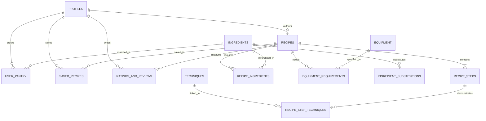

# Luto (Logo: Lu2) — System Architecture Specification
**Universal, Community-Driven, Offline-First Mobile Cooking Platform**
_Document Version: 1.0.0 · Status: Final Architecture Specification · Date: October 2026_

---

## 1. Executive Summary & Vision

**Luto** (branded as **Lu2**, derived from the universal root for cooking / culinary preparation) is a community-driven, cross-platform mobile cooking application engineered for high kitchen resilience, zero-network operational capability, and intelligent pantry management.

### Core Value Pillars
1. **Offline-First Kitchen Resilience**: Kitchens are notorious network dead zones (faraday cage refrigerators, basement apartments, remote outdoor cooking). All saved recipes, step instructions, and technique micro-videos must operate seamlessly without internet connectivity.
2. **"What's in My Fridge?" Pantry Engine**: Dynamic matching and scoring algorithm that transforms available ingredients into delicious meals while reducing food waste.
3. **Dynamic Culinary Substitution Engine**: Rule-based ingredient mapping that provides precise conversion ratios, context limits (baking vs. sautéing), and sensory impact warnings when ingredients are missing.
4. **Distraction-Free Cooking Mode**: Large-format, touchless/voice-friendly step-by-step guidance with multi-timer management and prerequisite technique micro-tutorials.
5. **Universal Community CRUD Platform**: Open, moderated culinary ecosystem allowing global home cooks to share, test, rate, and refine recipes across cultural boundaries.

---

## 2. Mobile Client Framework Architecture

### 2.1 Framework Evaluation: React Native / Expo vs. Flutter

| Architectural Vector | React Native + Expo (SDK 51+) | Flutter (Dart 3.x) | Evaluation & Decision for Luto |
| :--- | :--- | :--- | :--- |
| **Offline Data & Local SQLite Sync** | Exceptional. Native support for **WatermelonDB** (SQLite via JSI with lazy loading, reactive observables) and **PowerSync** for Supabase. | Good. **Drift** (SQLite ORM) is solid, but Supabase offline sync bridges have smaller community adoption. | **React Native / Expo wins** for robust offline synchronization libraries built specifically for Supabase. |
| **Media Pre-caching & Offline Storage** | `expo-file-system` + `react-native-fast-image` / `expo-image` (memory + disk LRU cache, background prefetching). | `cached_network_image` + `path_provider`. Highly capable. | **Tie**. Both handle local binary file caching and chunked video loading reliably. |
| **Developer Velocity & Multi-Agent Dispatch** | High. TypeScript across full stack (Supabase Edge Functions, database types, mobile client). Standard JSON ecosystem. | Medium. Dart isolation requires separate client language and duplicate model definitions. | **React Native / Expo wins** on unified TypeScript type-sharing from Postgres schema to UI. |
| **Native Bridge & Performance** | New Architecture (Hermes engine + JSI Nitro modules) eliminates old asynchronous JSON bridge overhead. 60–120 FPS. | Impeller engine renders directly via Vulkan / Metal. Excellent 120 FPS. | **Tie**. Hermes + New Architecture provides parity for data-driven applications. |
| **Kitchen Mode & Hardware APIs** | `expo-keep-awake`, `expo-speech` / Web Speech API, `react-native-sound` / `expo-av`, background notifications. | Native platform channels, `wakelock_plus`, `flutter_sound`. | **Tie**. All target kitchen sensors and audio feedback loops are well-supported. |

### 2.2 Framework Decision
**Selected Stack**: **React Native with Expo (Managed Workflow, New Architecture enabled) + TypeScript**.
- **Engine**: Hermes JS Engine.
- **Local Database**: **WatermelonDB** (backed by SQLite via JSI) for sub-millisecond local queries, lazy relation loading, and reactive UI updates.
- **Media Cache Manager**: `expo-image` paired with a dedicated background media download manager using `expo-file-system` to persist step media and technique micro-videos locally.
- **State Management**: Zustand (lightweight client UI state, active cooking timers) + TanStack Query v5 (server cache & network mutations).

```
+--------------------------------------------------------------------------------+
|                             React Native (Expo) Client                         |
|                                                                                |
|  +--------------------+  +--------------------+  +--------------------------+  |
|  |   Cooking Mode UI  |  |  Pantry Filter UI  |  |   Community Submission   |  |
|  +---------+----------+  +---------+----------+  +------------+-------------+  |
|            |                       |                          |                |
|  +---------v-----------------------v--------------------------v-------------+  |
|  |                 Zustand State & TanStack Query Layer                     |  |
|  +---------------------------------+----------------------------------------+  |
|                                    |                                           |
|  +---------------------------------v----------------------------------------+  |
|  |                 WatermelonDB Reactive Layer (JSI SQLite)                 |  |
|  |   - recipes_cache           - user_pantry_local    - cached_techniques   |  |
|  +-----------------+-----------------------------------+--------------------+  |
|                    |                                   |                       |
|  +-----------------v------------------+  +-------------v--------------------+  |
|  |  Expo FileSystem Offline Storage   |  |    Offline Sync Engine           |  |
|  |  - WebP Hero & Step Images         |  |    (Conflict Resolution & Queue) |  |
|  |  - H.265 / MP4 Micro-Video Loops   |  |    - Monotonic Timestamp LWW     |  |
|  +------------------------------------+  +-------------+--------------------+  |
+--------------------------------------------------------|-----------------------+
                                                         | HTTPS / WSS
                                                         v
+--------------------------------------------------------------------------------+
|                         Supabase Backend (PostgreSQL 16)                       |
|                                                                                |
|  +--------------------+  +--------------------+  +--------------------------+  |
|  |   Supabase Auth    |  |  PostgREST API /   |  |     Supabase Storage     |  |
|  |   (JWT / OAuth)    |  |  Edge Functions    |  |     (CDN Media Buckets)  |  |
|  +--------------------+  +---------+----------+  +--------------------------+  |
|                                    |                                           |
|  +---------------------------------v----------------------------------------+  |
|  |                 PostgreSQL 16 Core Engine with RLS                       |  |
|  |   - recipes             - ingredients          - equipment               |  |
|  |   - user_pantry         - recipe_ingredients   - techniques              |  |
|  |   - saved_recipes       - ratings_reviews      - substitution_rules      |  |
|  +--------------------------------------------------------------------------+  |
+--------------------------------------------------------------------------------+
```

---

## 3. Backend & Cloud Architecture (Supabase)

### 3.1 Core Backend Services
- **Database**: PostgreSQL 16 managed by Supabase.
- **Authentication**: Supabase Auth (Email/Password, Google OAuth, Apple Sign-In, and Anonymous Guest Auth for zero-friction pantry onboarding).
- **Storage**: Supabase Storage (S3-compatible) with Cloudflare global CDN edge caching.
- **Compute**: Supabase Edge Functions (Deno / TypeScript) for complex calculations (automated nutritional aggregation, spam classification, recipe import parsers).

### 3.2 Storage Buckets Architecture
1. `recipe-media` (Public Read):
   - Path structure: `recipes/{recipe_id}/hero_{hash}.webp`, `recipes/{recipe_id}/steps/{step_number}_{hash}.webp`.
   - Max file size: 5 MB per image. Format constrained to WebP/AVIF via client-side compression before upload.
2. `technique-videos` (Public Read):
   - Path structure: `techniques/{technique_slug}/micro_{resolution}.mp4`.
   - Optimized 5–15 second seamless silent video loops (H.264/H.265) capped at 8 MB.
3. `user-uploads-quarantine` (Private, Authenticated):
   - Temporary staging bucket for community recipe submissions pending automated virus/safety screening before migration to `recipe-media`.

### 3.3 Security & Row Level Security (RLS) Policy Specifications

```sql
-- Enable RLS across all tables
ALTER TABLE profiles ENABLE ROW LEVEL SECURITY;
ALTER TABLE recipes ENABLE ROW LEVEL SECURITY;
ALTER TABLE recipe_steps ENABLE ROW LEVEL SECURITY;
ALTER TABLE recipe_ingredients ENABLE ROW LEVEL SECURITY;
ALTER TABLE user_pantry ENABLE ROW LEVEL SECURITY;
ALTER TABLE saved_recipes ENABLE ROW LEVEL SECURITY;
ALTER TABLE ratings_and_reviews ENABLE ROW LEVEL SECURITY;

-- 1. Profiles: Public can view user usernames/avatars; only owner can update
CREATE POLICY "Public profiles are viewable by everyone" 
  ON profiles FOR SELECT USING (true);
CREATE POLICY "Users can insert their own profile" 
  ON profiles FOR INSERT WITH CHECK (auth.uid() = id);
CREATE POLICY "Users can update their own profile" 
  ON profiles FOR UPDATE USING (auth.uid() = id);

-- 2. Recipes: Published recipes are public; Drafts only visible to author/admin
CREATE POLICY "Published recipes are viewable by everyone" 
  ON recipes FOR SELECT 
  USING (status = 'published' OR auth.uid() = author_id OR auth.jwt() ->> 'role' = 'moderator');
CREATE POLICY "Authenticated users can create recipes" 
  ON recipes FOR INSERT 
  WITH CHECK (auth.role() = 'authenticated' AND auth.uid() = author_id);
CREATE POLICY "Authors can update their own recipes" 
  ON recipes FOR UPDATE 
  USING (auth.uid() = author_id);
CREATE POLICY "Authors can delete their own draft recipes" 
  ON recipes FOR DELETE 
  USING (auth.uid() = author_id AND status = 'draft');

-- 3. User Pantry: Strictly isolated to the owning user
CREATE POLICY "Users can view their own pantry items" 
  ON user_pantry FOR SELECT 
  USING (auth.uid() = user_id);
CREATE POLICY "Users can insert into their own pantry" 
  ON user_pantry FOR INSERT 
  WITH CHECK (auth.uid() = user_id);
CREATE POLICY "Users can update their own pantry" 
  ON user_pantry FOR UPDATE 
  USING (auth.uid() = user_id);
CREATE POLICY "Users can delete from their own pantry" 
  ON user_pantry FOR DELETE 
  USING (auth.uid() = user_id);

-- 4. Saved Recipes / Favorites: Strictly isolated to owner
CREATE POLICY "Users can view their saved recipes" 
  ON saved_recipes FOR SELECT 
  USING (auth.uid() = user_id);
CREATE POLICY "Users can manage their saved recipes" 
  ON saved_recipes FOR ALL 
  USING (auth.uid() = user_id);

-- 5. Reviews: Everyone can read reviews; Authenticated users can write 1 review per recipe
CREATE POLICY "Reviews are public" 
  ON ratings_and_reviews FOR SELECT USING (true);
CREATE POLICY "Users can create reviews" 
  ON ratings_and_reviews FOR INSERT 
  WITH CHECK (auth.role() = 'authenticated' AND auth.uid() = user_id);
CREATE POLICY "Users can update their own reviews" 
  ON ratings_and_reviews FOR UPDATE 
  USING (auth.uid() = user_id);
```

---

## 4. Relational Database Schema & Data Models (PostgreSQL 16)

### 4.1 Entity Relationship Diagram (ERD)



### 4.2 Database DDL Specifications

```sql
-- Setup required extensions
CREATE EXTENSION IF NOT EXISTS "uuid-ossp";
CREATE EXTENSION IF NOT EXISTS "pg_trgm"; -- For fuzzy ingredient search

-- 1. Profiles Table
CREATE TABLE profiles (
    id UUID PRIMARY KEY REFERENCES auth.users(id) ON DELETE CASCADE,
    username VARCHAR(50) UNIQUE NOT NULL,
    display_name VARCHAR(100) NOT NULL,
    avatar_url TEXT,
    bio TEXT,
    measurement_preference VARCHAR(10) DEFAULT 'metric' CHECK (measurement_preference IN ('metric', 'imperial')),
    dietary_preferences TEXT[] DEFAULT '{}',
    skill_level VARCHAR(20) DEFAULT 'intermediate' CHECK (skill_level IN ('beginner', 'intermediate', 'advanced', 'pro')),
    created_at TIMESTAMPTZ DEFAULT NOW() NOT NULL,
    updated_at TIMESTAMPTZ DEFAULT NOW() NOT NULL
);

-- 2. Master Ingredients Dictionary
CREATE TABLE ingredients (
    id UUID PRIMARY KEY DEFAULT uuid_generate_v4(),
    canonical_name VARCHAR(150) UNIQUE NOT NULL,
    display_name VARCHAR(150) NOT NULL,
    category VARCHAR(50) NOT NULL CHECK (category IN (
        'protein', 'produce', 'dairy', 'pantry_dry', 'canned', 
        'bakery', 'spice_seasoning', 'oil_fat', 'condiment', 'liquid'
    )),
    is_staple BOOLEAN DEFAULT FALSE NOT NULL, -- True for salt, black pepper, water, oil
    default_unit VARCHAR(30) NOT NULL,
    average_shelf_life_days INT,
    allergen_tags TEXT[] DEFAULT '{}',
    density_g_per_ml NUMERIC(6,3), -- For accurate volumetric/gravimetric conversions
    created_at TIMESTAMPTZ DEFAULT NOW() NOT NULL
);

-- 3. Master Kitchen Equipment Dictionary
CREATE TABLE equipment (
    id UUID PRIMARY KEY DEFAULT uuid_generate_v4(),
    canonical_name VARCHAR(100) UNIQUE NOT NULL,
    display_name VARCHAR(100) NOT NULL,
    category VARCHAR(50) NOT NULL CHECK (category IN (
        'cookware', 'bakeware', 'knives_cutlery', 'prep_tools', 
        'appliances', 'measuring', 'utensils'
    )),
    is_essential BOOLEAN DEFAULT TRUE NOT NULL,
    icon_name VARCHAR(50) NOT NULL,
    description TEXT,
    created_at TIMESTAMPTZ DEFAULT NOW() NOT NULL
);

-- 4. Master Cooking Techniques Catalog
CREATE TABLE techniques_and_skills (
    id UUID PRIMARY KEY DEFAULT uuid_generate_v4(),
    canonical_slug VARCHAR(100) UNIQUE NOT NULL,
    title VARCHAR(150) NOT NULL,
    category VARCHAR(50) NOT NULL CHECK (category IN (
        'knife_skills', 'dry_heat', 'moist_heat', 'combination', 
        'sauces_emulsions', 'baking_pastry', 'prep_finishing'
    )),
    difficulty_level VARCHAR(20) DEFAULT 'beginner' CHECK (difficulty_level IN ('beginner', 'intermediate', 'advanced')),
    summary TEXT NOT NULL,
    micro_video_url TEXT,
    gif_preview_url TEXT,
    key_tips TEXT[] NOT NULL DEFAULT '{}',
    common_mistakes TEXT[] NOT NULL DEFAULT '{}',
    created_at TIMESTAMPTZ DEFAULT NOW() NOT NULL
);

-- 5. Recipes Master Table
CREATE TABLE recipes (
    id UUID PRIMARY KEY DEFAULT uuid_generate_v4(),
    author_id UUID NOT NULL REFERENCES profiles(id) ON DELETE CASCADE,
    title VARCHAR(200) NOT NULL,
    slug VARCHAR(250) UNIQUE NOT NULL,
    description TEXT NOT NULL,
    cuisine_tags TEXT[] DEFAULT '{}',
    category VARCHAR(50) NOT NULL,
    difficulty VARCHAR(20) NOT NULL CHECK (difficulty IN ('easy', 'medium', 'hard', 'expert')),
    prep_time_minutes INT NOT NULL CHECK (prep_time_minutes >= 0),
    cook_time_minutes INT NOT NULL CHECK (cook_time_minutes >= 0),
    total_time_minutes INT GENERATED ALWAYS AS (prep_time_minutes + cook_time_minutes) STORED,
    servings INT NOT NULL DEFAULT 4 CHECK (servings > 0),
    calories_per_serving INT,
    nutritional_facts JSONB DEFAULT '{}'::jsonb, -- { protein_g, carbs_g, fat_g, fiber_g, sodium_mg }
    hero_image_url TEXT NOT NULL,
    status VARCHAR(20) DEFAULT 'draft' CHECK (status IN ('draft', 'pending_review', 'published', 'archived')),
    average_rating NUMERIC(3,2) DEFAULT 0.00,
    ratings_count INT DEFAULT 0,
    version INT DEFAULT 1 NOT NULL,
    created_at TIMESTAMPTZ DEFAULT NOW() NOT NULL,
    updated_at TIMESTAMPTZ DEFAULT NOW() NOT NULL
);

-- 6. Recipe Steps
CREATE TABLE recipe_steps (
    id UUID PRIMARY KEY DEFAULT uuid_generate_v4(),
    recipe_id UUID NOT NULL REFERENCES recipes(id) ON DELETE CASCADE,
    step_number INT NOT NULL,
    title VARCHAR(150),
    instruction TEXT NOT NULL,
    media_url TEXT,
    media_type VARCHAR(20) CHECK (media_type IN ('image', 'video', 'gif')),
    timer_duration_seconds INT DEFAULT 0,
    timer_label VARCHAR(100),
    is_critical BOOLEAN DEFAULT FALSE,
    created_at TIMESTAMPTZ DEFAULT NOW() NOT NULL,
    CONSTRAINT unique_step_per_recipe UNIQUE (recipe_id, step_number)
);

-- 7. Recipe Step Techniques Link Table
CREATE TABLE recipe_step_techniques (
    recipe_step_id UUID NOT NULL REFERENCES recipe_steps(id) ON DELETE CASCADE,
    technique_id UUID NOT NULL REFERENCES techniques_and_skills(id) ON DELETE CASCADE,
    PRIMARY KEY (recipe_step_id, technique_id)
);

-- 8. Recipe Ingredients Junction
CREATE TABLE recipe_ingredients (
    id UUID PRIMARY KEY DEFAULT uuid_generate_v4(),
    recipe_id UUID NOT NULL REFERENCES recipes(id) ON DELETE CASCADE,
    ingredient_id UUID NOT NULL REFERENCES ingredients(id) ON DELETE RESTRICT,
    amount NUMERIC(8,3) NOT NULL CHECK (amount > 0),
    unit VARCHAR(30) NOT NULL, -- 'g', 'ml', 'tbsp', 'tsp', 'cup', 'piece', 'clove'
    display_text VARCHAR(200) NOT NULL, -- e.g. "2 medium onions, finely diced"
    is_optional BOOLEAN DEFAULT FALSE NOT NULL,
    sort_order INT NOT NULL DEFAULT 0,
    created_at TIMESTAMPTZ DEFAULT NOW() NOT NULL
);

-- 9. Recipe Equipment Requirements Junction
CREATE TABLE equipment_requirements (
    recipe_id UUID NOT NULL REFERENCES recipes(id) ON DELETE CASCADE,
    equipment_id UUID NOT NULL REFERENCES equipment(id) ON DELETE RESTRICT,
    is_required BOOLEAN DEFAULT TRUE NOT NULL,
    notes VARCHAR(200),
    PRIMARY KEY (recipe_id, equipment_id)
);

-- 10. User Pantry
CREATE TABLE user_pantry (
    id UUID PRIMARY KEY DEFAULT uuid_generate_v4(),
    user_id UUID NOT NULL REFERENCES profiles(id) ON DELETE CASCADE,
    ingredient_id UUID NOT NULL REFERENCES ingredients(id) ON DELETE CASCADE,
    quantity NUMERIC(8,3),
    unit VARCHAR(30),
    storage_location VARCHAR(30) DEFAULT 'fridge' CHECK (storage_location IN ('fridge', 'freezer', 'pantry', 'spice_rack')),
    expiration_date DATE,
    is_staple BOOLEAN DEFAULT FALSE,
    added_at TIMESTAMPTZ DEFAULT NOW() NOT NULL,
    updated_at TIMESTAMPTZ DEFAULT NOW() NOT NULL,
    CONSTRAINT unique_user_ingredient UNIQUE (user_id, ingredient_id)
);

-- 11. Saved Recipes & Offline Cache State
CREATE TABLE saved_recipes (
    id UUID PRIMARY KEY DEFAULT uuid_generate_v4(),
    user_id UUID NOT NULL REFERENCES profiles(id) ON DELETE CASCADE,
    recipe_id UUID NOT NULL REFERENCES recipes(id) ON DELETE CASCADE,
    is_favorite BOOLEAN DEFAULT TRUE NOT NULL,
    is_downloaded_offline BOOLEAN DEFAULT FALSE NOT NULL,
    downloaded_at TIMESTAMPTZ,
    local_sync_version INT DEFAULT 1,
    personal_notes TEXT,
    created_at TIMESTAMPTZ DEFAULT NOW() NOT NULL,
    updated_at TIMESTAMPTZ DEFAULT NOW() NOT NULL,
    CONSTRAINT unique_user_saved_recipe UNIQUE (user_id, recipe_id)
);

-- 12. Ratings & Community Reviews
CREATE TABLE ratings_and_reviews (
    id UUID PRIMARY KEY DEFAULT uuid_generate_v4(),
    recipe_id UUID NOT NULL REFERENCES recipes(id) ON DELETE CASCADE,
    user_id UUID NOT NULL REFERENCES profiles(id) ON DELETE CASCADE,
    rating INT NOT NULL CHECK (rating BETWEEN 1 AND 5),
    difficulty_score INT CHECK (difficulty_score BETWEEN 1 AND 5),
    review_text TEXT,
    photos TEXT[] DEFAULT '{}',
    pro_tips TEXT,
    helpful_votes INT DEFAULT 0,
    created_at TIMESTAMPTZ DEFAULT NOW() NOT NULL,
    updated_at TIMESTAMPTZ DEFAULT NOW() NOT NULL,
    CONSTRAINT unique_user_recipe_review UNIQUE (recipe_id, user_id)
);

-- 13. Dynamic Ingredient Substitutions Matrix
CREATE TABLE ingredient_substitutions (
    id UUID PRIMARY KEY DEFAULT uuid_generate_v4(),
    original_ingredient_id UUID NOT NULL REFERENCES ingredients(id) ON DELETE CASCADE,
    substitute_ingredient_id UUID NOT NULL REFERENCES ingredients(id) ON DELETE CASCADE,
    conversion_ratio NUMERIC(5,3) NOT NULL, -- Multiply original amount by ratio
    category VARCHAR(50) NOT NULL,
    applicable_contexts TEXT[] NOT NULL DEFAULT '{"all"}', -- e.g. {"baking", "sautéing", "sauces"}
    forbidden_contexts TEXT[] NOT NULL DEFAULT '{}',
    flavor_impact TEXT NOT NULL,
    texture_impact TEXT NOT NULL,
    preparation_note TEXT,
    created_at TIMESTAMPTZ DEFAULT NOW() NOT NULL
);
```

### 4.3 Automated Rating Rollup Trigger
```sql
CREATE OR REPLACE FUNCTION update_recipe_rating_stats()
RETURNS TRIGGER AS $$
BEGIN
    UPDATE recipes
    SET 
        average_rating = COALESCE((
            SELECT ROUND(AVG(rating)::numeric, 2) 
            FROM ratings_and_reviews 
            WHERE recipe_id = COALESCE(NEW.recipe_id, OLD.recipe_id)
        ), 0.00),
        ratings_count = (
            SELECT COUNT(*) 
            FROM ratings_and_reviews 
            WHERE recipe_id = COALESCE(NEW.recipe_id, OLD.recipe_id)
        ),
        updated_at = NOW()
    WHERE id = COALESCE(NEW.recipe_id, OLD.recipe_id);
    RETURN NEW;
END;
$$ LANGUAGE plpgsql;

CREATE TRIGGER trg_ratings_rollup
AFTER INSERT OR UPDATE OR DELETE ON ratings_and_reviews
FOR EACH ROW EXECUTE FUNCTION update_recipe_rating_stats();
```
